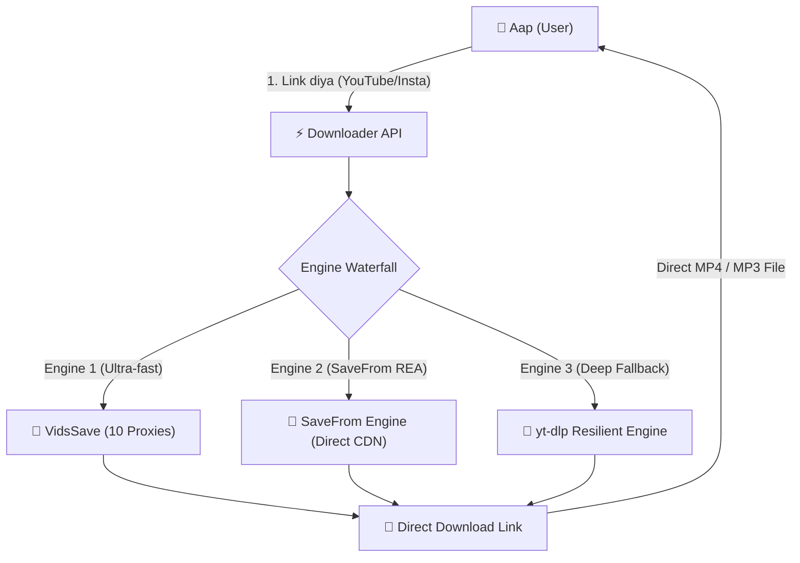

# 🎬 Media Downloader REST API — Complete Beginner-Friendly Guide 🚀

> **"Link daalo aur Video/Audio download paao!"**  
> Yeh API kisi bhi video platform (YouTube, Shorts, Instagram Reels, TikTok, Twitter/X, Facebook) ka link lekar aapko direct **MP4 Video** ya **MP3 Audio** download link bana kar deta hai.

---

## 🌟 Live Links (Abhi Test Karein!)

| Suvidha | Link | Description |
| :--- | :--- | :--- |
| 🌐 **Live API Base** | [`https://down-api-fuye.onrender.com/`](https://down-api-fuye.onrender.com/) | API ka home aur health check |
| 🕹️ **Interactive Docs** | [`https://down-api-fuye.onrender.com/docs`](https://down-api-fuye.onrender.com/docs) | Browser se bina code likhe API try karein |
| ⚡ **Live Logs Dashboard**| [`https://down-api-fuye.onrender.com/logs`](https://down-api-fuye.onrender.com/logs) | Server ke live requests aur proxy status |
| 📊 **JSON Logs** | [`https://down-api-fuye.onrender.com/api/logs`](https://down-api-fuye.onrender.com/api/logs) | Server stats aur uptime JSON me |

---

## 🧒 Bilkul Aasan Bhasha Me: Yeh Kaam Kaise Karta Hai?



1. **Aapne URL diya** (Example: YouTube Shorts ya Video ka link).
2. **Multi-Engine Waterfall**:
   - **Engine 1: VidsSave** (10 Residential Proxies ke saath fast API).
   - **Engine 2: SaveFrom** (Reverse-engineered SaveFrom.net client signature + decryptor bina captcha ke).
   - **Engine 3: yt-dlp** (Datacenter-safe Android/VisionOS client fallback).
3. **Aapko Download Link mil gaya**: Browser ya app me click karte hi direct streamable video ya audio save ho jaati hai!

---

## 🎯 Quick Cheat-Sheet: Kaunsa URL Kab Use Karein?

| Aapko Kya Karna Hai? | Use Karne Wala URL |
| :--- | :--- |
| **Video ki jaankari dekhni hai** (Title, Thumbnail, Duration, Resolutions) | `GET /api/info?url={VIDEO_URL}&engine=auto` |
| **Direct Video Download Link chahiye** (720p / 1080p / 360p MP4) | `GET /api/download?url={VIDEO_URL}&type=video&quality=720p` |
| **Sirf Audio / Gaana chahiye** (MP3 / M4A) | `GET /api/download?url={VIDEO_URL}&type=audio` |
| **SaveFrom Engine se nikalna hai** | `GET /api/info?url={VIDEO_URL}&engine=savefrom` |
| **Browser me click karte hi direct file download start karwani hai** | `GET /api/stream?url={VIDEO_URL}&type=video` |

---

## 📖 Detail Step-by-Step Guide Har Endpoint Ke Liye

### 1. 🔍 Video Ki Jaankari Lena (`/api/info`)

Yeh endpoint video ka title, thumbnail photo, duration (kitne second ki hai), aur kaun-kaun se format available hain batata hai.

#### 🌐 URL Format:
```text
https://down-api-fuye.onrender.com/api/info?url=YOUR_VIDEO_URL
```

#### 💡 Live Example:
```text
https://down-api-fuye.onrender.com/api/info?url=https://www.youtube.com/watch?v=dQw4w9WgXcQ
```

#### 📦 API Response (JSON Example):
```json
{
  "status": "success",
  "engine": "vidssave",
  "id": "dQw4w9WgXcQ",
  "title": "Rick Astley - Never Gonna Give You Up (Official Video)",
  "duration": 213,
  "thumbnail": "https://i.ytimg.com/vi/dQw4w9WgXcQ/hq720.jpg",
  "videos": [
    { "quality": "1080P", "format": "MP4", "size": 65123900 },
    { "quality": "720P", "format": "MP4", "size": 29968068 },
    { "quality": "480P", "format": "MP4", "size": 18230100 },
    { "quality": "360P", "format": "MP4", "size": 10540000 }
  ],
  "audios": [
    { "quality": "128KBPS", "format": "MP3", "size": 3449447 }
  ]
}
```

---

### 2. ⬇️ Direct Download Link Prapt Karna (`/api/download`)

Yeh endpoint direct high-speed CDN download URL deta hai jise aap kisi bhi browser me open kar sakte hain ya app me Download button ke pichhe laga sakte hain.

#### ⚙️ Parameters:
- `url` *(Zaroori)*: Video ka link.
- `type` *(Optional)*: `video` (default) ya `audio`.
- `quality` *(Optional)*: `best` (default), `720p`, `1080p`, `480p`, `360p`.
- `format` *(Optional)*: `mp4` ya `mp3`.

#### 🎬 Case A: Video Download Karni Hai (720p MP4)
```text
https://down-api-fuye.onrender.com/api/download?url=https://www.youtube.com/watch?v=dQw4w9WgXcQ&type=video&quality=720p
```

#### 🎵 Case B: Sirf Audio / MP3 Gaana Download Karna Hai
```text
https://down-api-fuye.onrender.com/api/download?url=https://www.youtube.com/watch?v=dQw4w9WgXcQ&type=audio
```

#### 📦 Response Example:
```json
{
  "status": "success",
  "engine": "vidssave",
  "title": "Rick Astley - Never Gonna Give You Up",
  "type": "video",
  "quality": "720P",
  "format": "MP4",
  "filesize": 29968068,
  "download_url": "https://down-de.vidssave.com/tmp/recycle/.../video.mp4"
}
```
👉 Bas `download_url` par click karein aur file download ho jayegi!

---

### 3. 🌊 Direct Stream Download (`/api/stream`)

Agar aap chahte hain ki user jaise hi link par click kare, browser seedhe file download ka dialog box open kar de (bina JSON response dikhaye):

```text
https://down-api-fuye.onrender.com/api/stream?url=https://www.youtube.com/watch?v=dQw4w9WgXcQ&type=video
```

---

### 4. 📊 Live Logs & Monitoring (`/logs` & `/api/logs`)

Server ke real-time stats dekhne ke liye:
- **Visual Web UI**: [https://down-api-fuye.onrender.com/logs](https://down-api-fuye.onrender.com/logs)
  - Har 3 second me auto-refresh hota hai.
  - Active Proxies count (e.g. `Proxies: 10 active`) dikhata hai.
  - Kaunsi request aayi, kitna time liya (ms), aur status kya raha, sab dikhta hai.
- **JSON API**: `GET /api/logs?limit=50`

---

## 💻 Copy-Paste Code Examples (Developers Ke Liye)

### 🐍 1. Python Code (`requests`)

```python
import requests

API_BASE = "https://down-api-fuye.onrender.com"
VIDEO_URL = "https://www.youtube.com/watch?v=dQw4w9WgXcQ"

# Step 1: Info nikalo
info = requests.get(f"{API_BASE}/api/info", params={"url": VIDEO_URL}).json()
print("Title:", info.get("title"))
print("Duration:", info.get("duration"), "seconds")

# Step 2: 720p Video Download URL nikalo
dl = requests.get(
    f"{API_BASE}/api/download",
    params={"url": VIDEO_URL, "type": "video", "quality": "720p"}
).json()

print("Direct Download Link:", dl.get("download_url"))
```

---

### 🌐 2. JavaScript / Node.js (`fetch`)

```javascript
const API_BASE = "https://down-api-fuye.onrender.com";
const videoUrl = "https://www.youtube.com/watch?v=dQw4w9WgXcQ";

async function getDownloadLink() {
  const res = await fetch(
    `${API_BASE}/api/download?url=${encodeURIComponent(videoUrl)}&type=video&quality=720p`
  );
  const data = await res.json();
  console.log("Title:", data.title);
  console.log("Download Link:", data.download_url);
}

getDownloadLink();
```

---

### 🖥️ 3. cURL (Terminal / Command Line)

```bash
# 1. Info dekhne ke liye
curl "https://down-api-fuye.onrender.com/api/info?url=https://www.youtube.com/watch?v=dQw4w9WgXcQ"

# 2. Download link lene ke liye
curl "https://down-api-fuye.onrender.com/api/download?url=https://www.youtube.com/watch?v=dQw4w9WgXcQ&type=video&quality=720p"

# 3. File seedhe disk par save karne ke liye
curl -OJ "https://down-api-fuye.onrender.com/api/stream?url=https://www.youtube.com/watch?v=dQw4w9WgXcQ&type=video"
```

---

### 🎨 4. Complete HTML Webpage (Ek Ready-to-use Downloader Website!)

Aap is code ko `index.html` naam se save karke kisi bhi browser me open kar sakte hain. Yeh ek pura video downloader web tool ban jayega:

```html
<!DOCTYPE html>
<html lang="hi">
<head>
  <meta charset="UTF-8">
  <title>Mera Video Downloader</title>
  <meta name="viewport" content="width=device-width, initial-scale=1.0">
  <style>
    body { font-family: sans-serif; background: #0f172a; color: #fff; padding: 30px; text-align: center; }
    .box { max-width: 500px; margin: auto; background: #1e293b; padding: 25px; border-radius: 12px; }
    input { width: 90%; padding: 12px; border-radius: 8px; border: 1px solid #334155; margin-bottom: 12px; background: #0f172a; color: #fff; }
    button { background: #38bdf8; color: #000; font-weight: bold; border: none; padding: 12px 24px; border-radius: 8px; cursor: pointer; font-size: 16px; }
    button:hover { background: #7dd3fc; }
    #result { margin-top: 20px; text-align: left; word-break: break-all; }
    img { max-width: 100%; border-radius: 8px; margin-top: 10px; }
  </style>
</head>
<body>
  <div class="box">
    <h2>🎬 Fast Video Downloader</h2>
    <input type="text" id="videoUrl" placeholder="YouTube, Shorts ya Insta link yahan paste karein...">
    <br>
    <button onclick="downloadMedia('video')">📹 Video Download</button>
    <button onclick="downloadMedia('audio')">🎵 Audio (MP3)</button>
    <div id="result"></div>
  </div>

  <script>
    async function downloadMedia(type) {
      const url = document.getElementById('videoUrl').value.trim();
      const resBox = document.getElementById('result');
      if (!url) return alert('Kripya pehle video link paste karein!');
      
      resBox.innerHTML = '⏳ Link generate ho raha hai, thoda intezar karein...';

      try {
        const res = await fetch(`https://down-api-fuye.onrender.com/api/download?url=${encodeURIComponent(url)}&type=${type}`);
        const data = await res.json();

        if (data.download_url) {
          resBox.innerHTML = `
            <h3>✅ ${data.title}</h3>
            ${data.thumbnail ? `` : ''}
            <p><b>Quality:</b> ${data.quality} (${data.format})</p>
            <a href="${data.download_url}" target="_blank">
              <button style="width:100%; margin-top:10px;">⬇️ Click Here to Download File</button>
            </a>
          `;
        } else {
          resBox.innerHTML = `❌ Error: ${data.detail || 'Download link nahi mila'}`;
        }
      } catch (err) {
        resBox.innerHTML = `❌ Error: ${err.message}`;
      }
    }
  </script>
</body>
</html>
```

---

## 🛡️ Backend Architecture (Kyun Yeh API Kabhi Band Nahi Hoti?)

1. **Dual Extraction Architecture:**
   - **Primary Engine (VidsSave):** Next.js backend se reverse-engineered AES-CBC decryption aur server-sent events (SSE) task processing.
   - **Secondary Engine (yt-dlp Resilient):** Agar primary engine delay kare to background me `android` & `visionos` clients bina kisi Cloudflare ya bot error ke fallback provide karte hain.
2. **10 Built-In Rotating Residential Proxies:**
   - Cloud datacenter blocks (`analyze_risk`) ko rokne ke liye har request automatically 10 high-speed proxies ke beech round-robin rotate hoti hai.
   - Kisi ek proxy par timeout aane par bina user ko error dikhaye turant agli proxy auto-failover karti hai.
3. **In-Memory Ring Buffer Logging:**
   - Har request ka latency, status code aur error track hota hai jise bina database ke `/logs` dashboard par realtime dekha ja sakta hai.
